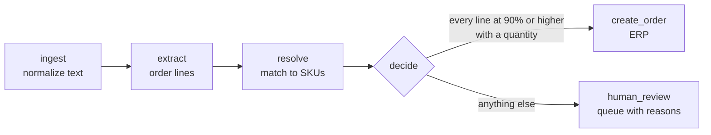

# LangGraph Order Taking Agent (demo)

A LangGraph agent that reads noisy WhatsApp-style order messages, matches each line to a SKU in a product master, creates the order automatically when every line is a confident match (90% or higher), and sends everything else to a human review queue with the reasons attached.

> This is a clean-room demonstration. It is not client code, and the product master, messages and customers are all made up. The extractor is rule-based so the demo runs with no API key and gives the same result every time.

## What it shows

- **A real LangGraph graph.** A typed state, six nodes and a conditional edge that routes each message to `create_order` or `human_review`.
- **Message noise handled on purpose.** Abbreviations (`vit c`, `azithro`), regional spellings (`paracitamol`, `cetrizine`, `khansi`), filler words (`hello bhai ... bhejo`), quantities written three different ways, and quantities with no unit.
- **A threshold you can reason about.** The match score has three visible parts, so a reviewer can see why a line was held back.
- **A review queue that helps.** Each held-back message carries the reasons and the agent's pre-filled lines, so a person starts from its best attempt.

## Quick start

Requires Python 3.10 or newer. The first run creates a `.venv` folder and installs LangGraph into it.

```bash
# macOS or Linux
./run.sh

# Windows
run.bat
```

| Command | What it does |
|---|---|
| `run.bat` or `./run.sh` | Runs the 17 sample messages through the graph |
| `run.bat test` or `./run.sh test` | Runs the unit tests |
| `run.bat msg "para 650 x 4"` | Runs a single message |
| `run.bat graph` | Prints the graph as a Mermaid diagram |

## Sample output

```
M001  auto_create   hello bhai, paracitamol 500 x 20 aur amoxicillin 500 cap 10 strip bhejo
      ok     'paracitamol 500 x 20'             -> SKU-1001 Paracetamol 500 mg Tablet, qty 20 strip, 96%
      ok     'amoxicillin 500 cap 10 strip bhejo' -> SKU-1010 Amoxicillin 500 mg Capsule, qty 10 strip, 100%
M003  human_review  cough syp 5
      review 'cough syp 5'                      -> candidates SKU-1040, SKU-1041, 65%
              because: 2 products fit (SKU-1040, SKU-1041); strength, form or variant not specified
M006  human_review  ibuprofen 400
      review 'ibuprofen 400'                    -> SKU-1050 Ibuprofen 400 mg Tablet, qty missing, 100%
              because: quantity missing
M014  human_review  paracet 500 3 strip
      review 'paracet 500 3 strip'              -> SKU-1001 Paracetamol 500 mg Tablet, qty 3 strip, 85%
              because: match 85% is below the 90% threshold

Messages              17
Orders auto-created   10  (59%)
Sent to human review  7  (41%)
```

Those percentages describe this small synthetic set. They are not an accuracy figure for any real system.

## The graph



| Node | Job |
|---|---|
| `ingest` | Lowercases the message and tidies whitespace |
| `extract` | Splits the message into lines and pulls out product words, strength, quantity, unit and form |
| `resolve` | Scores each line against the product master and picks a SKU, or lists the candidates |
| `decide` | Chooses the route for the whole message |
| `create_order` | Sends the order to the ERP (a stand-in class in this demo) |
| `human_review` | Builds the review item with reasons and pre-filled lines |

One bad line sends the whole message to review, so a person never receives half an order.

## How a line is scored

| Part | Effect |
|---|---|
| Text similarity to the closest product name or alias | Exact is 1.00. Near-miss spellings land around 0.90 to 0.95. A plain abbreviation prefix such as `paracet` is held at 0.80 |
| A number in the message matches the product's strength | Adds 0.05 |
| More than one product still fits | Multiplies the score by 0.65, so it falls under the threshold |
| The requested form does not exist for the product | Halves the score |

A line is resolved automatically only when it has one SKU, a score at or above the threshold, and a quantity. The threshold is `DEFAULT_THRESHOLD` in `order_agent/resolve.py`, or `--threshold` on the command line.

How quantities and strengths are told apart: a number that matches a strength of the matched product is the strength, and a single leftover number is the quantity. `ibuprofen 400` therefore reads 400 as the strength and reports the quantity as missing.

## Using an LLM for extraction

The `extract` node has one contract: normalized text in, a list of `ExtractedLine` out. The rule-based version in `order_agent/extract.py` can be swapped for an LLM call that returns the same fields, and the matching, thresholding and routing stay as they are. The demo keeps the extractor rule-based so that it runs offline and the tests are deterministic.

## Project layout

```
order_agent/
  catalog.py     product master loading
  extract.py     message to order lines (rule-based)
  resolve.py     scoring and SKU matching
  graph.py       the LangGraph graph and a stand-in ERP
  cli.py         command line interface
sample_data/
  product_master.csv   14 made-up products with aliases
  messages.jsonl       17 made-up messages with a hand-written expected route
tests/             17 unit and graph tests
run.sh, run.bat    one-command runners
```

## Tests

```bash
run.bat test        # or ./run.sh test
```

The tests cover extraction, scoring, the threshold, and the graph. The graph tests check that each sample message takes the route written beside it in `messages.jsonl`. I wrote those labels by hand while building the rules, so they confirm the behaviour is consistent and intended. They do not measure accuracy on unseen messages.

## Limits

- The extractor handles the noise patterns in the sample data. New phrasing needs new rules or an LLM extractor.
- Misspellings are caught by string similarity, which suits short product names but is not semantic search. Retrieval over a larger product master would use embeddings.
- The ERP is a stand-in that records orders in memory.
